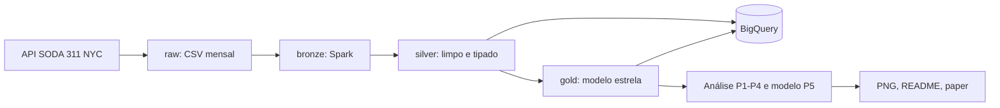
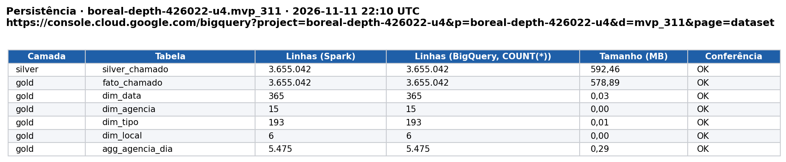
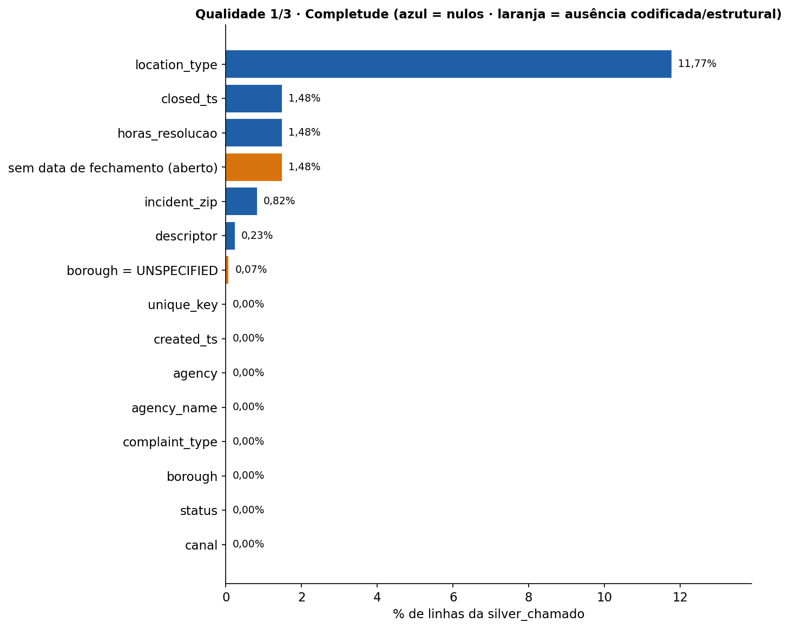
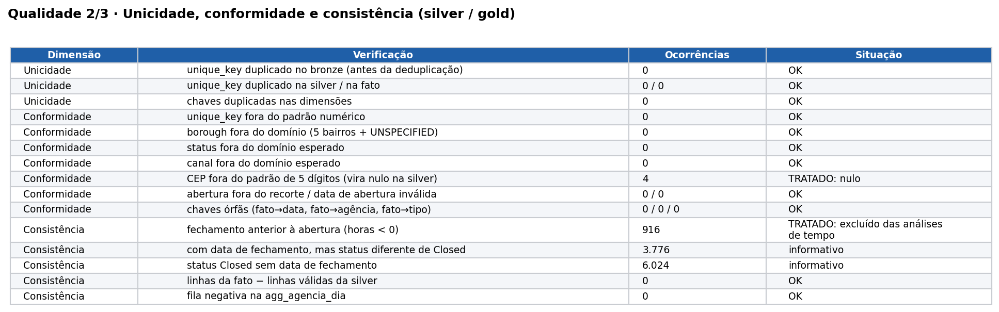
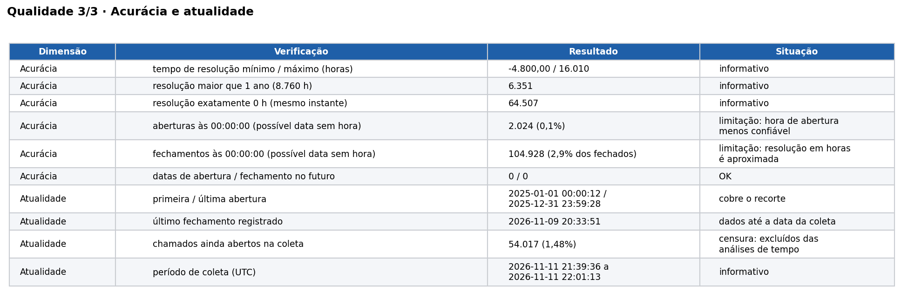
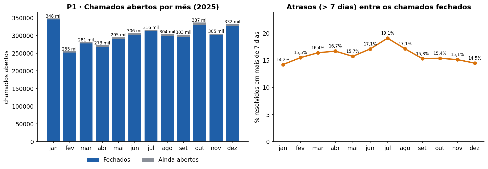
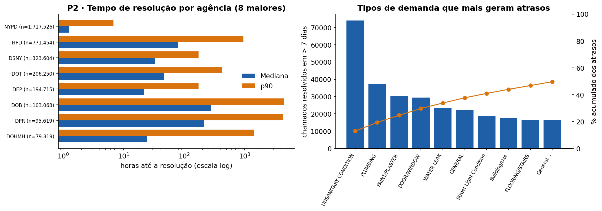
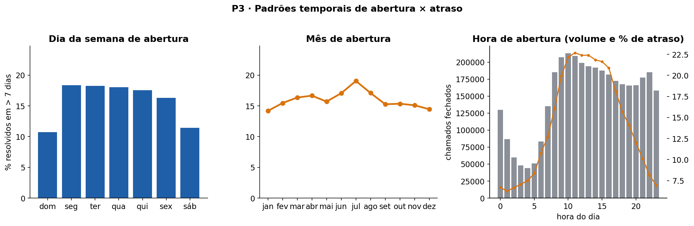
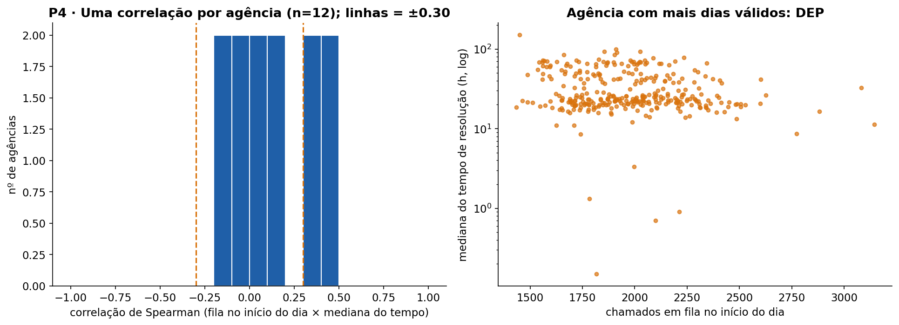
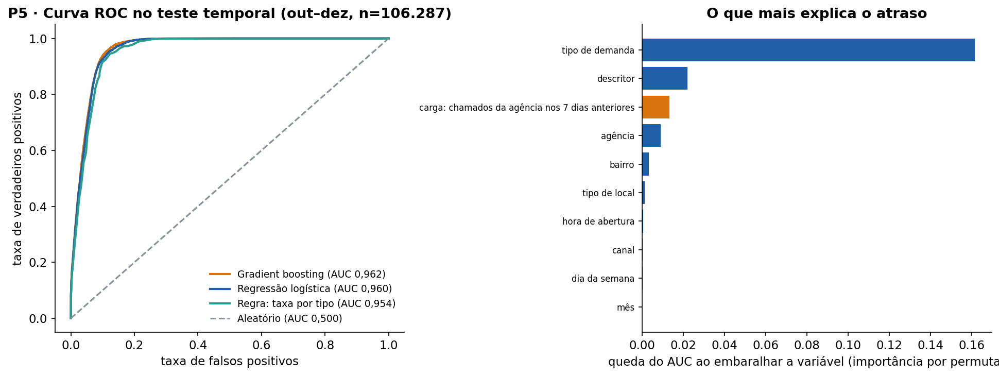

# MVP — O tempo de resolução de chamados de serviço público é previsível já na abertura?

**Pipeline de dados em nuvem (Google Colab + PySpark + BigQuery Sandbox) com NYC Open Data · 311 Service Requests**
Universidade de Brasília · Departamento de Engenharia de Produção · Prof. André Luiz Marques Serrano
Aluno: Daniel de Carvalho Vianna (matrícula 231013322) · Trabalho individual · Introdução à Ciência de Dados

---

## Resumo
Este MVP analisa 3.655.042 chamados abertos em 2025 no serviço 311 da cidade de Nova York e pergunta se o prazo de atendimento pode ser previsto no momento da abertura. Os dados foram coletados pela API pública, processados em PySpark (arquitetura medalhão), gravados no BigQuery e analisados com estatística descritiva, correlações por agência e um modelo de classificação com validação temporal. Resultado principal: 16,0% dos chamados fechados levaram mais de 7 dias; o modelo de gradient boosting, com variáveis conhecidas na abertura, atingiu ROC-AUC de 0,962 no teste temporal (regra simples por tipo: 0,954), e a mediana do |ρ| entre fila e tempo foi 0,12. Veredito pelo critério declarado: hipótese **CONFIRMADA**.

## Sumário
1. [Objetivo](#1-objetivo) · 2. [Plataforma e arquitetura](#2-plataforma-e-arquitetura) · 3. [Dados](#3-dados) · 4. [Modelagem](#4-modelagem) · 5. [Carga (ETL)](#5-carga-etl) · 6. [Qualidade dos dados](#6-qualidade-dos-dados) · 7. [Resultados e discussão](#7-resultados-e-discussão) · 8. [Autoavaliação](#8-autoavaliação) · 9. [Como reproduzir](#9-como-reproduzir) · 10. [Estrutura do repositório](#10-estrutura-do-repositório)



## 1. Objetivo

### 1.1 Problema
Serviços públicos urbanos funcionam como um sistema de filas: chamados chegam, esperam e são atendidos por equipes de capacidade limitada. Na Engenharia de Produção, o **lead time** (tempo entre a abertura e a resolução), a fila e o cumprimento de prazos (SLA) são medidas centrais de desempenho. Se o prazo de cada chamado puder ser previsto na abertura, a organização consegue informar prazos realistas ao cidadão, priorizar o acompanhamento dos casos de risco e dimensionar capacidade. Este MVP testa essa possibilidade com dados reais do serviço 311 de Nova York.

**Recorte:** chamados abertos de 01/01/2025 a 31/12/2025. Foi escolhido um ano completo e recente, em que a maioria dos chamados já está fechada na data da coleta (2026-11-11).

### 1.2 Hipótese
> O tempo de resolução é determinado principalmente pela natureza do chamado (agência e tipo de demanda), conhecida na abertura, e pouco pela carga de trabalho do dia. Portanto, os atrasos (resolução em mais de 7 dias) são previsíveis já na abertura.

A hipótese é refutável: se um modelo com as variáveis da abertura não conseguir separar os chamados atrasados dos demais, ou se a fila explicar fortemente o tempo de resolução, ela é rejeitada.

**Critério de veredito (definido antes da execução):** C1 = ROC-AUC do modelo no teste temporal (aberturas de 01/10 a 31/12) ≥ 0,80; C2 = mediana do valor absoluto da correlação de Spearman entre a fila da agência no início do dia e o tempo de resolução (uma correlação por agência) < 0,30. Confirmada se C1 e C2; parcialmente confirmada se só um; refutada se nenhum. Os limiares são escolha do autor.

### 1.3 Perguntas de negócio
| # | Pergunta | Decisão que apoia |
|---|---|---|
| P1 | Como evoluiu, mês a mês em 2025, o volume de chamados abertos e a parcela resolvida em mais de 7 dias? | Dimensionar a carga de trabalho e a capacidade |
| P2 | Quais agências e tipos de demanda concentram os atrasos? | Direcionar esforço de melhoria de processo |
| P3 | O momento da abertura (dia da semana, hora, mês) altera a chance de atraso? | Planejar escalas e turnos |
| P4 | A carga de trabalho da agência (fila no início do dia) está associada ao tempo de resolução? | Testar a relação fila–tempo (Lei de Little) e decidir sobre capacidade |
| P5 | É possível prever, na abertura, se um chamado será resolvido em mais de 7 dias? | Informar prazo esperado ao cidadão e priorizar acompanhamento |

> Se alguma pergunta não for plenamente respondida, ela permanece nesta lista e é discutida na autoavaliação (seção 8).

## 2. Plataforma e arquitetura

- **Plataforma:** Google Colab (execução) + **BigQuery Sandbox** (persistência na nuvem; gratuito, sem cartão). Custo de operação: zero (Colab gratuito, API pública sem chave, BigQuery Sandbox). No Sandbox as tabelas expiram por padrão em 60 dias; as evidências em PNG deste repositório registram o estado da carga.
- **Arquitetura medalhão:** raw (CSV mensais no disco do Colab) → bronze (tabela Spark, dado como veio) → silver (limpo/tipado, regras de negócio) → gold (modelo estrela e agregado de carga). **Silver e gold são gravadas no BigQuery**.
- **Linguagens e bibliotecas:** Python (coleta, PySpark local 3.5.3 com modo ANSI ligado, pandas, scipy, scikit-learn) e SQL (qualidade e análise).
- **Execução:** um único notebook, [`MVP_311_PRAZO.ipynb`](MVP_311_PRAZO.ipynb), executável com "Executar tudo".

## 3. Dados

| Fonte | Conteúdo | Licença / termos | Formato original |
|---|---|---|---|
| [NYC Open Data · 311 Service Requests from 2010 to Present](https://data.cityofnewyork.us/Social-Services/311-Service-Requests-from-2010-to-Present/erm2-nwe9) (API SODA, dataset `erm2-nwe9`) | Chamados de serviço: datas de abertura/fechamento, agência, tipo, local (bairro e CEP), canal, status | Dados abertos da cidade de Nova York; [termos de uso](https://www.nyc.gov/html/data/terms.html) | CSV paginado (50.000 linhas por requisição) |

- **Data da coleta:** 2026-11-11 21:39:36 a 2026-11-11 22:01:13 (UTC); registro completo em `coleta_meta.json`.
- **Volume obtido:** 3.655.042 linhas em 80 arquivos CSV (727,2 MB), em 12 meses, sem token de aplicativo (pausa de 1,0 s entre requisições). O total informado pela API (`count(*)`, 3.655.042) foi conferido mês a mês com o total gravado.
- **Colunas coletadas:** `unique_key`, `created_date`, `closed_date`, `agency`, `complaint_type`, `borough`, `status`, `agency_name`, `descriptor`, `location_type`, `incident_zip`, `open_data_channel_type`. Não foram coletados endereço, coordenadas nem texto livre.
- **Dados pessoais (LGPD):** as colunas coletadas não identificam pessoas (apenas agência, tipo de demanda, bairro, CEP e datas). **Dados corporativos:** nenhum.
- Os dados brutos **não** são versionados no GitHub (volume); o notebook reproduz a obtenção.

## 4. Modelagem

Modelo **estrela** na camada gold (grão da fato: um chamado):
`fato_chamado` · `dim_data` · `dim_agencia` · `dim_tipo` · `dim_local` · `agg_agencia_dia` (carga por agência e dia). Diagrama, **Catálogo de Dados completo (domínios, obrigatoriedade e linhagem)** em [`catalogo_dados.md`](catalogo_dados.md).

## 5. Carga (ETL)

O notebook [`MVP_311_PRAZO.ipynb`](MVP_311_PRAZO.ipynb) executa, em ordem:

| Células | Função |
|---|---|
| 1–3 | Configuração, autenticação Google (única ação humana), projeto/dataset no BigQuery, dependências |
| 4 | Coleta mensal da API SODA (retry com backoff, retomada, auditoria contra `count(*)`) |
| 5 | Spark local e camada **bronze** |
| 6 | Camada **silver** (limpeza, tipagem, regras de negócio) |
| 7 | Camada **gold** (modelo estrela e carga por agência/dia) |
| 8 | Carga **silver + gold no BigQuery** e conferência de contagens |
| 10 | Qualidade (6 dimensões) |
| 11–13 | Análise P1–P4, modelo P5, gráficos e evidência de persistência |
| 14–16 | Geração automática de README, catálogo, paper (.tex) e .zip |

**Regras de negócio aplicadas na transformação**
1. Datas: `created_date` e `closed_date` convertidas com `TRY_CAST` (inválida vira nula). O horário da fonte é o horário local de Nova York, tratado como "relógio de parede"; só as diferenças entre datas são usadas.
2. Textos: *trim*, espaços repetidos colapsados, vazio vira nulo; agência e bairro em maiúsculas; CEP válido apenas com 5 dígitos.
3. Deduplicação: uma linha por `unique_key`, mantendo a de `closed_date` mais recente.
4. Recorte: abertura entre 01/01/2025 e 31/12/2025.
5. `horas_resolucao` = fechamento − abertura, em horas (nula se não fechado; negativa mantida na gold e excluída das análises de tempo).
6. `flag_atraso` = resolução maior que 168 horas (7 dias); só definida para chamados fechados com resolução ≥ 0.
7. Carga por agência e dia (`agg_agencia_dia`): `fila_inicio_dia` = chamados da agência já abertos e ainda não fechados no início do dia (apenas chamados de 2025 que foram fechados depois; começa subestimada em janeiro); `criados_7d_ant` = chamados criados nos 7 dias anteriores.
8. Modelo: usa só variáveis conhecidas na abertura (a `fila_inicio_dia` não entra, por usar informação do futuro); treino até 30/09 e teste a partir de 01/10.

**Persistência na nuvem:** projeto/dataset `boreal-depth-426022-u4.mvp_311`; console: https://console.cloud.google.com/bigquery?project=boreal-depth-426022-u4&p=boreal-depth-426022-u4&d=mvp_311&page=dataset. Evidência: 

## 6. Qualidade dos dados

Executada na célula 10 do notebook (completude, unicidade, conformidade, consistência, acurácia, atualidade).

| Dimensão | Verificação | Resultado | Tratamento |
|---|---|---|---|
| Completude | % de nulos por atributo (silver_chamado) e ausências estruturais | maiores ausências: location_type 11,8%; closed_ts 1,5%; horas_resolucao 1,5%; sem data de fechamento (aberto) 1,5% | Sem fechamento → fora das análises de tempo (reportado); demais ausências mantidas e tratadas como "ND" no modelo |
| Unicidade | `unique_key` duplicado (bronze, silver, fato) e chaves das dimensões | bronze: 0; silver: 0; fato: 0; dimensões: 0 | Deduplicação na silver (mantém a linha com `closed_date` mais recente) |
| Conformidade | padrão do ID, bairro, status, canal, CEP, recorte e chaves órfãs | ID fora do padrão: 0; bairro fora do domínio: 0; status fora do esperado: 0; canal fora do esperado: 0; CEP inválido: 4; órfãs: 0 | CEP inválido vira nulo; valores novos de status/canal são mantidos e listados no catálogo |
| Consistência | fechamento ≥ abertura; status × data de fechamento | fechamento antes da abertura: 916; com fechamento e status ≠ Closed: 3.776; Closed sem data: 6.024 | Resolução negativa excluída das análises de tempo (mantida na gold) |
| Acurácia | tempo de resolução extremo; datas sem hora | resolução entre -4.800,00 h e 16.010 h; maior que 1 ano: 6.351; aberturas às 00:00:00: 0,1% | Mantidos; hora de abertura tratada como menos confiável (limitação) |
| Atualidade | última abertura / último fechamento / ainda abertos | abertura 2025-12-31 23:59:28; fechamento 2026-11-09 20:33:51; abertos na coleta: 54.017 (1,48%) | Abertos excluídos das análises de tempo (censura à direita) |

Evidências:   

## 7. Resultados e discussão

Base de análise: 3.655.042 chamados abertos de 01/01/2025 a 31/12/2025; para as análises de tempo, 3.600.109 chamados fechados com resolução válida (excluídos 54.933: ainda abertos ou com fechamento anterior à abertura).

### P1 — Volume mensal e atrasos


| Mês | Chamados | Fechados | % fechados | Fechados em > 7 dias | % em > 7 dias |
|---|---|---|---|---|---|
| jan | 348.180 | 345.589 | 99,3% | 49.030 | 14,2% |
| fev | 255.364 | 251.826 | 98,6% | 38.921 | 15,5% |
| mar | 281.221 | 277.285 | 98,6% | 45.348 | 16,4% |
| abr | 272.549 | 267.658 | 98,2% | 44.596 | 16,7% |
| mai | 295.060 | 290.675 | 98,5% | 45.635 | 15,7% |
| jun | 306.442 | 302.917 | 98,8% | 51.688 | 17,1% |
| jul | 315.883 | 311.886 | 98,7% | 59.419 | 19,1% |
| ago | 304.039 | 298.652 | 98,2% | 51.049 | 17,1% |
| set | 302.684 | 296.105 | 97,8% | 45.199 | 15,3% |
| out | 336.612 | 329.974 | 98,0% | 50.663 | 15,4% |
| nov | 304.905 | 300.752 | 98,6% | 45.409 | 15,1% |
| dez | 332.103 | 327.706 | 98,7% | 47.372 | 14,5% |

**Resultado e discussão:** Foram abertos 3.655.042 chamados em 2025 (média de 10.014 por dia). O mês de maior volume foi janeiro (348.180) e o de menor volume foi fevereiro (255.364). Na data da coleta, 98,5% dos chamados já estavam fechados. Entre os 3.600.109 chamados fechados com tempo de resolução válido, 16,0% levaram mais de 7 dias, com variação mensal de 14,2% (janeiro) a 19,1% (julho). O tempo mediano de resolução foi de 6,6 h (0,3 dias) e o p90, de 411 h (17,1 dias). Foram excluídos das análises de tempo 54.933 chamados (1,5%): os ainda abertos e os com fechamento anterior à abertura.

### P2 — Agências e tipos de demanda


| Agência | Chamados fechados | % do total | Mediana (h) | p90 (h) | % > 7 dias |
|---|---|---|---|---|---|
| NYPD | 1.717.526 | 47,7% | 1,3 | 7 | 0,0% |
| HPD | 771.454 | 21,4% | 79,2 | 956 | 35,3% |
| DSNY | 323.604 | 9,0% | 32,7 | 174 | 10,7% |
| DOT | 206.250 | 5,7% | 46,3 | 421 | 27,3% |
| DEP | 194.715 | 5,4% | 21,6 | 174 | 11,9% |
| DOB | 103.068 | 2,9% | 278,2 | 4.446 | 55,1% |
| DPR | 95.619 | 2,7% | 214,9 | 4.291 | 53,4% |
| DOHMH | 79.819 | 2,2% | 24,1 | 1.440 | 36,3% |
| DHS | 45.456 | 1,3% | 8,1 | 259 | 12,7% |
| TLC | 30.161 | 0,8% | 1.673,0 | 5.990 | 78,0% |

| Tipo de demanda | Chamados | Atrasos (> 7 dias) | % do tipo | % dos atrasos |
|---|---|---|---|---|
| UNSANITARY CONDITION | 117.413 | 74.021 | 63,0% | 12,9% |
| PLUMBING | 69.305 | 37.096 | 53,5% | 6,5% |
| PAINT/PLASTER | 59.103 | 30.220 | 51,1% | 5,3% |
| DOOR/WINDOW | 45.260 | 29.335 | 64,8% | 5,1% |
| WATER LEAK | 38.302 | 23.288 | 60,8% | 4,1% |
| GENERAL | 32.988 | 22.317 | 67,7% | 3,9% |
| Street Light Condition | 31.516 | 18.684 | 59,3% | 3,3% |
| Building/Use | 20.758 | 17.378 | 83,7% | 3,0% |

**Resultado e discussão:** As três agências com mais chamados fechados são: NYPD (47,7% dos chamados, mediana de 1,3 h, 0,0% acima de 7 dias); HPD (21,4% dos chamados, mediana de 79,2 h, 35,3% acima de 7 dias); DSNY (9,0% dos chamados, mediana de 32,7 h, 10,7% acima de 7 dias). Entre as agências com pelo menos 1.000 chamados, a taxa de atraso varia de 0,0% a 100,0%. Os atrasos são concentrados: três agências respondem por 67,1% dos 574.329 chamados resolvidos em mais de 7 dias e os dez tipos de demanda com mais atrasos respondem por 49,6%. Os tipos que mais geram atrasos são: UNSANITARY CONDITION (74.021 atrasos, 63,0% dos seus chamados); PLUMBING (37.096 atrasos, 53,5% dos seus chamados); PAINT/PLASTER (30.220 atrasos, 51,1% dos seus chamados).

### P3 — Momento da abertura


| Dia de abertura | Chamados fechados | Mediana (h) | % > 7 dias |
|---|---|---|---|
| dom | 478.206 | 3,0 | 10,7% |
| seg | 537.769 | 10,8 | 18,4% |
| ter | 536.489 | 12,3 | 18,3% |
| qua | 527.424 | 10,8 | 18,1% |
| qui | 517.590 | 10,2 | 17,5% |
| sex | 524.081 | 6,4 | 16,3% |
| sáb | 478.550 | 3,1 | 11,5% |

**Resultado e discussão:** A taxa de atraso (> 7 dias) varia 7,7 pontos percentuais entre os dias da semana de abertura (maior em segunda-feira, 18,4%; menor em domingo, 10,7%), 4,9 p.p. entre os meses e 16,4 p.p. entre as horas do dia (considerando horas com ao menos 1.000 chamados). Para comparação, a diferença entre as agências é de 100,0 p.p., 6,1 vezes a maior variação temporal. Cautela: 0,1% das aberturas estão registradas exatamente à meia-noite, o que indica registros sem hora e limita a leitura da hora de abertura.

### P4 — Carga de trabalho × tempo de resolução


| Agência | Dias válidos | ρ fila | ρ criados 7d |
|---|---|---|---|
| DEP | 334 | -0,11 | -0,16 |
| DPR | 334 | 0,49 | 0,63 |
| DOT | 334 | 0,39 | -0,29 |
| DOHMH | 334 | -0,13 | -0,51 |
| HPD | 334 | 0,12 | -0,76 |
| NYPD | 334 | 0,19 | -0,51 |
| DSNY | 334 | -0,06 | 0,10 |
| DOB | 333 | -0,09 | 0,05 |

**Resultado e discussão:** Em 12 agências com ao menos 60 dias válidos (cada dia com no mínimo 30 chamados fechados), a correlação de Spearman entre a fila no início do dia e a mediana do tempo de resolução dos chamados abertos naquele dia tem mediana 0,09 (associação praticamente nula) e mediana do valor absoluto 0,12; 33% das agências têm |ρ| ≥ 0,30. Usando os chamados criados nos 7 dias anteriores como medida de carga, a mediana do |ρ| é 0,13. Pela Lei de Little (L = λW), com capacidade fixa uma fila maior tenderia a vir acompanhada de tempos maiores; a magnitude observada indica quanto disso aparece nos dados. Cautela: a fila usa só chamados abertos em 2025 que foram fechados depois e começa subestimada em janeiro (por isso o período de análise começa em fevereiro), e correlação não implica causalidade.

### P5 — Modelo preditivo


| Modelo | ROC-AUC | AP (PR-AUC) | Precisão no decil de maior risco | Atrasos capturados no decil |
|---|---|---|---|---|
| Gradient boosting (variáveis da abertura) | 0,962 | 0,774 | 75,2% | 50,2% |
| Regressão logística (one-hot) | 0,960 | 0,767 | 74,7% | 49,9% |
| Regra: taxa de atraso por tipo de demanda | 0,954 | 0,734 | 71,9% | 48,1% |

| Variável | Queda do AUC (permutação) |
|---|---|
| tipo de demanda | 0,162 |
| descritor | 0,022 |
| carga: chamados da agência nos 7 dias anteriores | 0,013 |
| agência | 0,009 |
| bairro | 0,003 |
| tipo de local | 0,001 |
| hora de abertura | 0,001 |
| canal | 0,000 |
| dia da semana | 0,000 |
| mês | 0,000 |

**Resultado e discussão:** Com validação temporal (treino: 293.481 chamados abertos até 30/09; teste: 106.287 abertos de 01/10 a 31/12; prevalência de atraso de 16,4% no treino e 15,0% no teste), o ROC-AUC no teste foi de 0,962 para o gradient boosting, 0,960 para a regressão logística e 0,954 para a regra simples de taxa de atraso por tipo de demanda (aleatório = 0,500). O ganho do modelo sobre a regra por tipo é de 0,007 em AUC. No limiar escolhido na validação (0,41), o modelo atinge precisão de 67,8%, revocação de 83,9% e F1 de 0,75. No decil de maior risco, 75,2% dos chamados de fato atrasam (contra 15,0% na média), e esse decil captura 50,2% de todos os atrasos. As variáveis de maior importância por permutação (queda do AUC) são: tipo de demanda (0,162), descritor (0,022), carga: chamados da agência nos 7 dias anteriores (0,013). A carga de trabalho (chamados da agência nos 7 dias anteriores) tem queda de AUC de 0,013. O modelo usa uma amostra de 399.768 chamados (11% da base de tempo).

### Discussão geral
Critério declarado antes da execução: a hipótese é CONFIRMADA se (C1) o ROC-AUC do modelo no teste temporal for maior ou igual a 0,80 e (C2) a mediana do valor absoluto da correlação de Spearman entre a fila da agência e o tempo de resolução for menor que 0,30; PARCIALMENTE CONFIRMADA se apenas um dos dois critérios for atendido; REFUTADA se nenhum for. Resultado: C1: ROC-AUC no teste = 0,962 (atende ≥ 0,80); C2: mediana do |ρ| entre fila e tempo = 0,12 (atende < 0,30). Veredito: hipótese CONFIRMADA. O atraso é razoavelmente previsível já na abertura e a carga diária da agência explica pouco do tempo de resolução. Na prática, isso sustenta informar ao cidadão um prazo esperado por tipo de demanda e agência e concentrar o acompanhamento nos chamados classificados como de alto risco, em vez de tratar a carga do dia como a principal causa dos atrasos. Ressalvas: os dados são de uma única cidade e de um único ano; o fechamento é um registro administrativo (pode não coincidir com a solução real do problema); parte das horas de abertura e fechamento é registrada à meia-noite; o AUC mede a capacidade de ordenar chamados por risco, não a calibração das probabilidades; e os limiares (0,80 e 0,30) são uma escolha do autor, explicitada para que o resultado seja auditável.

## 8. Autoavaliação

1. **Perguntas respondidas / não respondidas e por quê:** P1 — respondida. P2 — respondida. P3 — respondida; ressalva: hora de abertura pouco confiável em parte dos registros. P4 — respondida; ressalva: fila interna ao recorte e correlação não é causalidade. P5 — respondida; ressalva: um ano de dados de uma cidade e uma amostra para o treino do modelo.
2. **Limitações dos dados:**
   - Uma única cidade e um único ano; os resultados podem não se generalizar a outros contextos.
   - "Fechado" é um registro administrativo: um chamado pode ser fechado sem que o problema tenha sido resolvido.
   - 0,1% das aberturas estão às 00:00:00, o que indica registros sem hora; a hora de abertura e a resolução em horas são aproximadas.
   - 1,5% dos chamados seguem abertos na coleta e ficam de fora das análises de tempo (censura à direita), o que pode subestimar os tempos longos.
   - A fila é calculada só com chamados de 2025 que foram fechados depois; não inclui chamados abertos antes do recorte.
   - O modelo foi treinado numa amostra de até 400 mil chamados e avaliado em um único corte temporal.
   - Os limiares do veredito (C1 e C2) são arbitrários, ainda que declarados.
3. **Decisões técnicas que mudaria:** usar BigQuery SQL diretamente em vez de Spark local, que é desnecessário para este volume; coletar com token de aplicativo para reduzir o risco de limitação; persistir os dados brutos na nuvem (por exemplo, no Cloud Storage), não apenas as tabelas silver/gold; validar o modelo em mais de um corte temporal.
4. **Extensões para uso contínuo:** coleta incremental por data de atualização, orquestração agendada, previsão do tempo (regressão ou análise de sobrevivência) em vez de só a classificação de atraso, inclusão de variáveis de processo (equipes, prioridades) e de clima/feriados, monitoramento de desempenho do modelo ao longo do tempo.

## 9. Como reproduzir
1. Abra https://console.cloud.google.com/bigquery com a conta Google que será usada e aceite o modo Sandbox (cria o projeto gratuito).
2. Abra o notebook [`MVP_311_PRAZO.ipynb`](MVP_311_PRAZO.ipynb) no [Google Colab](https://colab.research.google.com) (Arquivo → Fazer upload de notebook).
3. Execute **Ambiente de execução → Executar tudo** e autorize o acesso à conta Google quando solicitado (única interação).
4. Aguarde (a coleta de cerca de 12 meses em páginas de 50 mil linhas leva em torno de uma hora, dependendo da API). Se o Colab desconectar, execute tudo de novo: a coleta é retomável enquanto o ambiente não for reiniciado.
5. Os arquivos gerados ficam em `saida/` e são baixados ao final (`saida.zip` e arquivos soltos).

## 10. Estrutura do repositório
Repositório com estrutura plana (todos os arquivos na raiz):
```
README.md · LICENSE
MVP_311_PRAZO.ipynb           (pipeline completo: coleta, ETL, BigQuery, qualidade, análise, modelo, geração de documentos)
catalogo_dados.md    (catálogo de dados + diagrama + linhagem)
coleta_meta.json     (data, volume e formato da coleta)
short_paper.tex      (artigo curto para o Overleaf; usa p1.png … p5.png)
persistencia.png · qualidade_1_*.png · qualidade_2_*.png · qualidade_3_*.png · p1.png … p5.png   (evidências)
```
