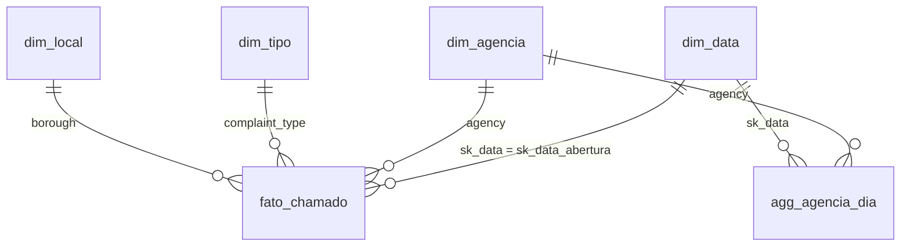

# Catálogo de Dados

Plataforma: Google Colab (PySpark) → **BigQuery Sandbox** (`boreal-depth-426022-u4.mvp_311`). Modelo: **estrela** na camada gold. Recorte: chamados abertos de 01/01/2025 a 31/12/2025.
Colunas "observado" foram calculadas pelo notebook sobre os dados reais carregados.

## Diagrama do modelo

## Linhagem geral

| Origem | Como foi obtida | Raw | Bronze | Silver | Gold |
|---|---|---|---|---|---|
| NYC Open Data · 311 Service Requests (`erm2-nwe9`) | Notebook `MVP_311_PRAZO.ipynb`, célula 4: CSV mensal pela API SODA, 50.000 linhas por página, sem token | `raw/311/*.csv` | `bronze_311` | `silver_chamado` | `fato_chamado`, `dim_agencia`, `dim_tipo`, `dim_local`, `agg_agencia_dia` |
| Calendário | Gerado por SQL (`sequence`) entre 2025-01-01 e 2025-12-31 | — | — | — | `dim_data` |

Data da coleta: **2026-11-11 21:39:36 a 2026-11-11 22:01:13 UTC** · 3.655.042 linhas, 727,2 MB.
Tabelas no BigQuery: `silver_chamado`, `fato_chamado`, `dim_data`, `dim_agencia`, `dim_tipo`, `dim_local`, `agg_agencia_dia`.

## fato_chamado (grão: um chamado) — 3.655.042 linhas

| Atributo | Tipo | Descrição | Domínio esperado | Domínio observado | Nulos? | Linhagem |
|---|---|---|---|---|---|---|
| unique_key | texto | Identificador do chamado | numérico, único | 3.655.042 distintos | Não | `unique_key` |
| sk_data_abertura | inteiro | Chave para `dim_data` (yyyyMMdd) | 20250101 a 20251231 | 20250101 a 20251231 | Não | `created_date` → data |
| hora_abertura | inteiro | Hora do dia da abertura | 0 a 23 | 0 a 23 | Não | `created_date` → hora |
| agency | texto | Sigla da agência responsável | maiúsculas | 15 agências | Não | `agency` |
| complaint_type | texto | Tipo de demanda | texto livre padronizado | 193 tipos | Não | `complaint_type` |
| descriptor | texto | Detalhe do tipo de demanda | texto | — | Sim (0,23% na silver) | `descriptor` |
| location_type | texto | Tipo de local | texto | — | Sim (11,77% na silver) | `location_type` |
| borough | categórico | Bairro (borough) | BRONX, BROOKLYN, MANHATTAN, QUEENS, STATEN ISLAND, UNSPECIFIED | BRONX, BROOKLYN, MANHATTAN, QUEENS, STATEN ISLAND, UNSPECIFIED | Não | `borough` |
| incident_zip | texto | CEP do incidente | 5 dígitos | 344 valores distintos | Sim (0,82% na silver) (CEP inválido vira nulo) | `incident_zip` |
| canal | categórico | Canal de abertura | PHONE, ONLINE, MOBILE, OTHER, UNKNOWN | MOBILE, ONLINE, OTHER, PHONE, UNKNOWN | Não | `open_data_channel_type` |
| status | categórico | Situação do chamado | Closed, Open, Pending, Assigned, Started, In Progress, Unspecified, Draft… | Assigned, Closed, In Progress, Open, Pending, Started, Unspecified | Não | `status` |
| created_ts | timestamp | Data/hora de abertura | dentro do recorte | 2025-01-01 00:00:12 a 2025-12-31 23:59:28 | Não | `created_date` |
| closed_ts | timestamp | Data/hora de fechamento | ≥ abertura | até 2026-11-09 20:33:51 | Sim: nulo = ainda aberto (1,48%) | `closed_date` |
| horas_resolucao | numérico | Fechamento − abertura, em horas | ≥ 0 | -4.800,00 a 16.010 (916 negativos) | Sim: nulo = ainda aberto | calculado |
| flag_fechado | booleano | Tem data de fechamento | true/false | 3.601.025 verdadeiros | Não | calculado |
| flag_atraso | booleano | Resolução > 168 h (7 dias) | true/false | 574.329 verdadeiros | Sim: nulo se aberto ou resolução negativa | calculado |
| fila_agencia_inicio_dia | inteiro | Chamados da agência abertos e ainda não fechados no início do dia da abertura | ≥ 0 | 0 a 37.059 | Não | `agg_agencia_dia` |
| criados_agencia_7d_ant | inteiro | Chamados criados pela agência nos 7 dias anteriores | ≥ 0 | 0 a 49.223 | Não | `agg_agencia_dia` |

## dim_data — 365 linhas

| Atributo | Tipo | Descrição | Domínio |
|---|---|---|---|
| sk_data | inteiro | Chave (yyyyMMdd) | 20250101 – 20251231 |
| data | data | Data completa | 2025-01-01 a 2025-12-31 |
| ano / trimestre / mes / dia | inteiro | Componentes | 2025 / 1–4 / 1–12 / 1–31 |
| dia_semana_num / dia_semana | inteiro / texto | 1 = domingo … 7 = sábado; nome em português | 1–7 |
| fim_de_semana | booleano | Sábado ou domingo | true/false |

## dim_agencia — 15 linhas
`agency` (chave), `agency_name` (nome da agência, primeiro valor não nulo), `n_chamados`.

## dim_tipo — 193 linhas
`complaint_type` (chave), `n_descritores` (descritores distintos), `n_chamados`.

## dim_local — 6 linhas
`borough` (chave), `n_cep` (CEPs distintos), `n_chamados`.

## agg_agencia_dia (agência × dia)
`agency`, `sk_data`, `criados`, `criados_fechados`, `fechados` (por data efetiva de fechamento), `fila_inicio_dia` (soma, nos dias anteriores, de `criados_fechados − fechados`; só chamados do recorte que foram fechados depois) e `criados_7d_ant` (soma de `criados` nos 7 dias anteriores).

## silver_chamado — 3.655.042 linhas
Atributos do fato mais as colunas originais tipadas. Nulos observados (%): unique_key 0,00%, created_ts 0,00%, closed_ts 1,48%, agency 0,00%, agency_name 0,00%, complaint_type 0,00%, descriptor 0,23%, location_type 11,77%, incident_zip 0,82%, borough 0,00%, status 0,00%, canal 0,00%, horas_resolucao 1,48%.
